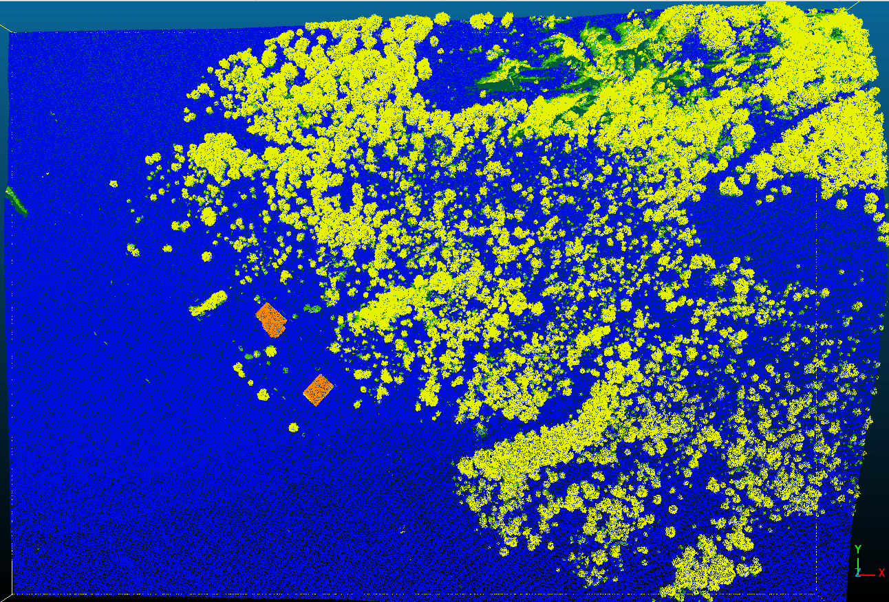
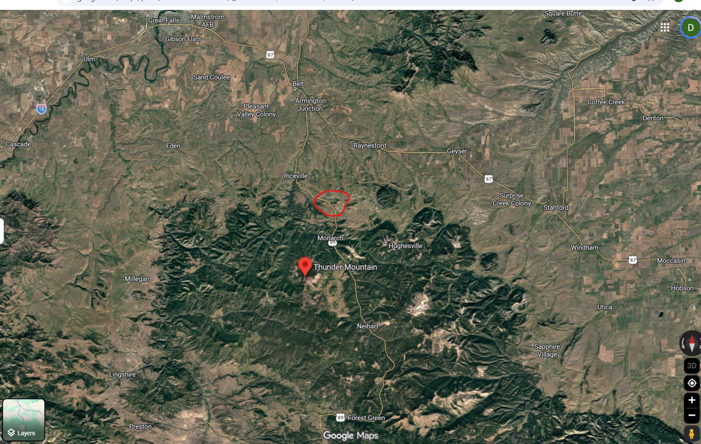
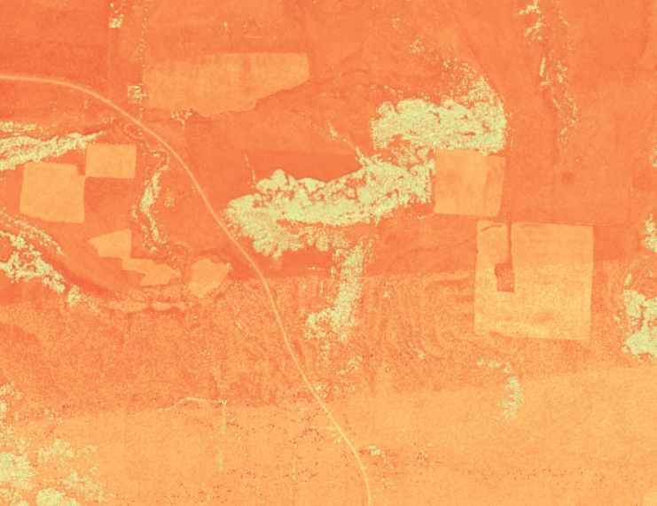
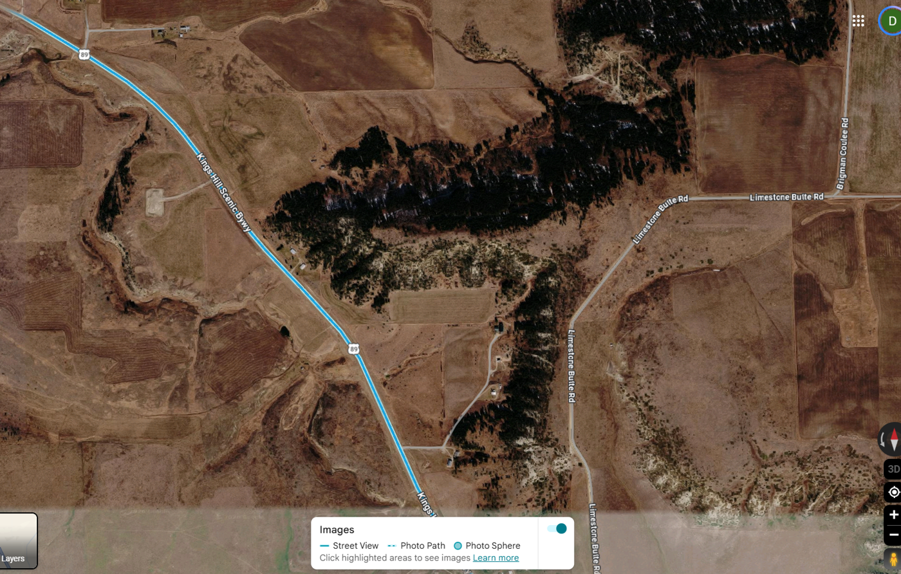
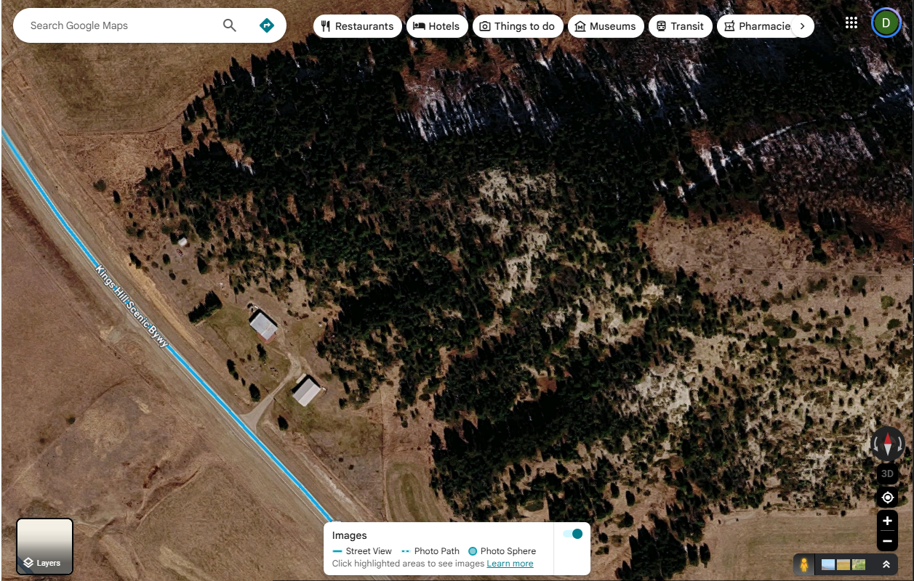
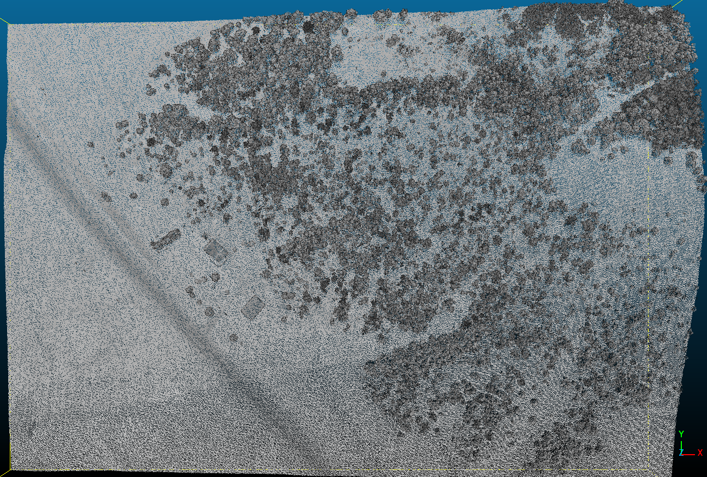
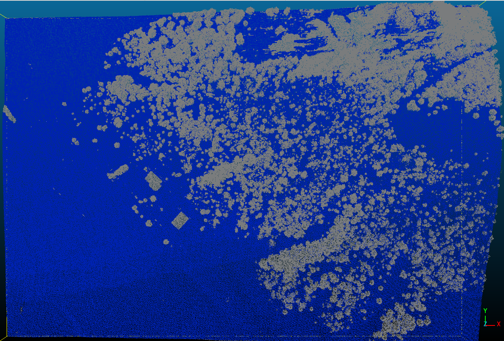
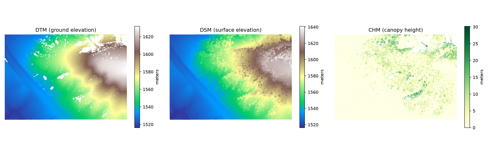
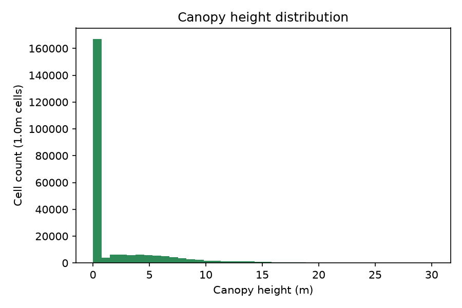
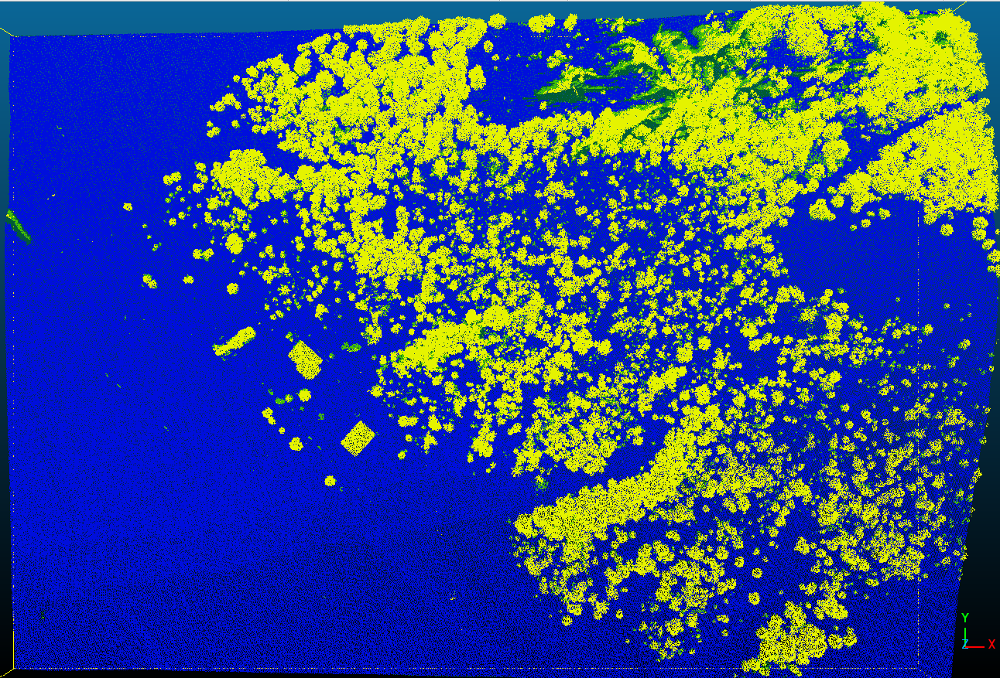

# LiDAR Canopy and Terrain Classification (Python + PDAL)

An end-to-end pipeline that takes a raw public airborne LiDAR point cloud of a wooded hillside and farm yard in rural Montana and turns it into a classified dataset: ground, vegetation height classes, and hand-corrected buildings. It also produces terrain, surface, and canopy height rasters and basic canopy statistics.



*Top-down view of the final classified point cloud (viewed in CloudCompare). Blue is ground, dark green is low vegetation, bright green is medium vegetation, yellow is high vegetation, and the two orange rectangles are barns that I labelled by hand.*

## What this project does

| Step | Script | What happens |
|---|---|---|
| 1 | `scripts/01_fetch_clip.py` | Streams a small bounding box out of the USGS 3DEP point cloud on AWS (EPT format) with PDAL, then reprojects it from Web Mercator to UTM Zone 12N so area and density math is correct |
| 2 | `scripts/02_dtm_dsm_chm.py` | Classifies ground points with the Cloth Simulation Filter, then builds a DTM, DSM, and canopy height model (CHM) by gridding points with pandas |
| 3 | `scripts/03_vegetation_classes.py` | Computes height above ground for every point and sorts non-ground points into low, medium, and high vegetation |
| 4 | Manual (CloudCompare) | Hand-labels the two barns as the ASPRS "Building" class, because height alone cannot separate a roof from a treetop |

Step 4 is a manual QA step, so it is not scripted. I checked that the edit persisted by re-reading the saved file and counting class values.

## Data

- **Source:** USGS 3DEP LiDAR, project `MT_Statewide_P3_3_B21`, hosted publicly on AWS (`s3://usgs-lidar-public`, no login required).
- **Clip:** about 601 m x 422 m (roughly 0.25 km2), 1,992,375 points, about 7.9 points per m2.
- Data files are not stored in this repo. Run script 01 to download the clip, and the later scripts build on it.

### Study area

I picked a wooded hillside with a farm yard so the scene would contain open field, forest, and a few buildings. These four images narrow in from the regional view to the exact extent of the clip.

**1. Regional view, with the study area circled.**



**2. The same area in the interactive USGS 3DEP point cloud viewer, where I chose the corners of the crop box.**



**3. A closer view of the area.**



**4. Imagery cropped to the exact extent of the clipped point cloud, framed to match the CloudCompare views in this repo. Compare it with the classified point cloud at the top of this page.**



*Images 1, 3, and 4 are Google Maps screenshots and image 2 is a screenshot of the USGS 3DEP viewer. I used them to orient the reader and to verify the point cloud against imagery.*

## Results, step by step

The four CloudCompare views below show the same point cloud at each stage, with the same framing, so you can flip between them. Colors follow the ASPRS classification codes: gray is unclassified or non-ground (1), blue is ground (2), dark green is low vegetation (3), bright green is medium vegetation (4), yellow is high vegetation (5), and orange is building (6).

### Step 1: Fetch and clip (`01_fetch_clip.py`)

The clip is 601 m by 422 m with 1,992,375 points, about 7.9 points per m2. As delivered, 60.5% of points are already labelled ground (class 2), 39.5% are class 1 (unclassified), and 1,625 are flagged as noise. This view is colored by return intensity so the raw returns stay visible.



*The raw clip, colored by intensity. Canopy shows up as darker clumps, a road runs diagonally along the left side, and the two barns are faintly visible at left center.*

### Step 2: Ground classification and terrain models (`02_dtm_dsm_chm.py`)

The Cloth Simulation Filter works out ground from the point geometry alone, without using the delivered labels, and writes its own ground and non-ground labels. They mark 61.9% of points as ground, compared with 60.5% in the delivered data. The same step then bins points into 1 m cells to build the DTM (lowest ground point per cell), the DSM (highest point of any kind per cell), and the CHM (DSM minus DTM).



*After the ground filter. Blue is ground and gray is everything else. The filter separates terrain from anything standing on it, but it cannot tell trees from buildings, so the barns are gray along with the trees.*





- Mean CHM is 1.96 m, median is 0.18 m, and max is 30.16 m. The mean and median include open ground cells, which is why the median is so low. Most of the scene is open field, as the histogram shows.
- 7.1% of 1 m cells contained no ground point. Dense canopy blocks pulses from reaching bare earth, so this reflects the physics of the survey rather than a processing bug.

**How the filter's ground compares with the delivered ground labels:**

| | Points | Share |
|---|---|---|
| Ground in both | 1,138,507 | 57.1% |
| Ground in the delivered labels only | 65,898 | 3.3% |
| Ground from the filter only | 95,032 | 4.8% |
| Not ground in either | 692,938 | 34.8% |

The two agree on 91.9% of points. Of the points the delivered data calls ground, the filter agrees on 94.5%, and of the points the filter calls ground, 92.3% match the delivered labels. This compares two algorithms, so it shows consistency rather than accuracy against surveyed ground.

### Step 3: Vegetation height classes (`03_vegetation_classes.py`)

Every non-ground point gets a height above ground, which is then sorted into three bands:

| ASPRS class | Meaning | Share of points |
|---|---|---|
| 2 | Ground | 61.9% |
| 3 | Low vegetation (under 0.5 m) | 3.0% |
| 4 | Medium vegetation (0.5 to 2 m) | 4.9% |
| 5 | High vegetation (2 m and up) | 30.2% |

The script treats every point that is not ground as vegetation, so the 13 points flagged as high noise in the delivered data are folded into these classes too.



*Blue is ground, dark green is low vegetation, bright green is medium vegetation, and yellow is high vegetation. This step uses height only, so the two barns are labelled high vegetation, the same as the treetops.*

### Step 4: Manual building correction (CloudCompare)

I drew polygons around the two barns and relabelled their points as class 6 (Building), which is how a height-only method gets corrected by hand. After the edit, 4,050 points are class 6. Of those, 3,528 had been vegetation (3,426 high, 101 medium, 1 low) and 522 had been ground. The ground points are probably ground at the edges of the barns that fell inside my polygons, or roof edges the filter had labelled ground. I have not checked which.


*The final result. The two barns, which were yellow in step 3, are now orange.*

## Things I ran into

- **Web Mercator distorts area.** The point cloud index uses EPSG:3857, whose meters are stretched by roughly 45% at this latitude. Cropping in it is fine, but I reproject to UTM 12N (EPSG:32612) before computing any density or area, which would otherwise be off by about 2x.
- **Zero-valued return number.** One point has a `ReturnNumber` of 0, which the ground filter rejects. Script 02 treats it as a single return instead of dropping it.
- **Computed fields vanish on export.** PDAL's LAS writer drops derived fields such as `HeightAboveGround` unless `extra_dims` is set.
- **Hand-edited files and compression.** Saving a classification edited in CloudCompare as compressed LAZ failed on a legacy versus extended flag mismatch, so the manually corrected output was saved as uncompressed LAS first.
- **Silent crash on Windows.** Running a conda environment's `python.exe` by raw path, instead of through `conda activate`, skipped its `Library\bin` PATH entry and caused a hard crash in a graphics library with no Python traceback.

## Limitations

- **Height is not shape.** Ground filtering and the vegetation bands use elevation geometry only, so any tall structure not hand-corrected (a roof, a pole) is counted as high vegetation. Building detection from planarity would be the next improvement.
- **Limited accuracy checking.** The only quantitative comparison is the ground filter against the ground labels already in the delivered data (91.9% agreement). Those labels come from another algorithm, not from surveyed ground, so this shows consistency rather than accuracy. The vegetation, building, and canopy height results were checked by eye against satellite and street-level imagery, and I have no reference data for them.
- **Edge effects.** The clip was cropped without a buffer, so classification right at the boundary has less neighborhood context. A better workflow crops with a margin, classifies, then trims.
- **Nearest-neighbor height above ground.** `filters.hag_nn` can create artificial seams on sparse, sloped terrain. One area of streaky low and medium vegetation, on a steep slope, may be a seam artifact or real terrain; I haven’t resolved which, but a Delaunay-based method is the alternative.
- **One site, discrete returns only.** This is a single small clip of discrete-return data, not full-waveform data.

## How this was built

I built this as a self-study project to learn airborne LiDAR processing from scratch. I used Claude as a coding and teaching assistant to write and explain the Python scripts, and I chose the dataset and study area, directed each step, ran the CloudCompare work by hand, and checked the results against imagery. The first pass of ground classification in CloudCompare and the Python version of the same filter gave different results, and the Python version was clearly better.

## Field notes

For the longer version, including how LiDAR works (explained through a seismic analogy), the vocabulary, a step-by-step walkthrough, and the full debugging log, see [docs/field-notes.md](docs/field-notes.md).

## Running it

```bash
conda env create -f environment.yml
conda activate lidar

# run from the repo root so the data/ paths resolve
python scripts/01_fetch_clip.py
python scripts/02_dtm_dsm_chm.py
python scripts/03_vegetation_classes.py
```

PDAL installs far more reliably through conda-forge than through pip, which is why this uses conda. Each script writes its output into `data/`, which is not tracked by git. The four point cloud views above are CloudCompare screenshots of the file saved at each step, and the DTM/DSM/CHM and histogram figures were copied from `data/` into `images/`.

## Tools

Python, PDAL (readers.ept, filters.reprojection, filters.csf, filters.hag_nn), pandas, NumPy, Matplotlib, pyproj, CloudCompare.

## Data attribution

Point cloud data from the USGS 3D Elevation Program (3DEP), a US government public domain dataset.
